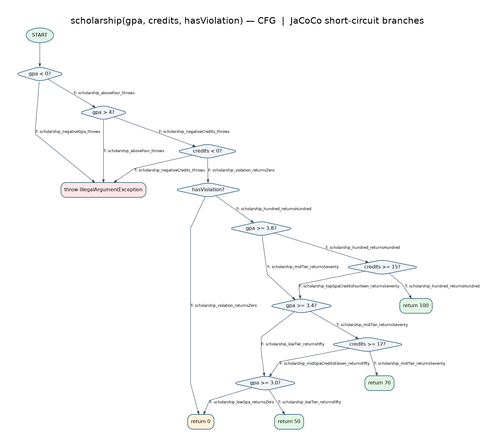

# Лаборатори №9 — JaCoCo код хамралт

**Хичээл:** F.CSA313 — Программ хангамжийн чанарын баталгаа ба тест  
**Оюутан:** Ө. Анар  
**Оюутны код:** B242270129  
**Тестийн бай:** `ScholarshipCalculator` (`letterGrade`, `gpa`, `scholarship`)  
**Эх сурвалж:** Багшийн starter project; `pom.xml` өөрчлөгдөөгүй.  
**AI ашиглалт:** Тестүүдийн хувилбар, Maven-ийн лог цуглуулах скрипт, CSV-ээс хамралт гаргах код болон CFG-ийн дижитал лавлах зургийг бэлтгэхэд ChatGPT ашигласан. Үр дүнгийн утга бүрийг өөрийн Maven/JaCoCo логуудаар нягталсан.

## Орчин

`java -version` бүтэн гаралт:

```text
openjdk version "21.0.12.1" 2026-08-18
OpenJDK Runtime Environment (build 21.0.12.1+1-1-deb13u1-Debian)
OpenJDK 64-Bit Server VM (build 21.0.12.1+1-1-deb13u1-Debian, mixed mode, sharing)
```

`mvn -version` бүтэн гаралт:

```text
Apache Maven 3.9.9
Maven home: /usr/share/maven
Java version: 21.0.12.1, vendor: Debian, runtime: /usr/lib/jvm/java-21-openjdk-amd64
Default locale: en_US, platform encoding: UTF-8
OS name: "linux", version: "6.12.113+deb13-amd64", arch: "amd64", family: "unix"
```

## Хэсэг A — Happy path, эхний хамралт

Эхний **5** тест ногоон ажилласан. Багшийн starter кодын зориуд алдаатай зааг (`score > 60`) энэ шатанд өөрчлөгдөөгүй. 

| Хэмжүүр | Covered | Missed | Хамралт |
|---|---:|---:|---:|
| Line | 14 | 11 | **56.00%** |
| Branch | 18 | 23 | **43.90%** |

Эхний 5 happy path тестээр A/B ангилал, эерэг оролттой GPA, тэтгэлэг олгох болон сахилгын зөрчилтэй замууд шалгагдсан. JaCoCo HTML тайлангийн шар ромб нь илэрхийллийн зөвхөн зарим салаа ажилласныг, улаан мөр нь тестээр огт дайраагүй замыг илтгэнэ. Тухайлбал хүчингүй оноо, `null`/хоосон массив, урьдчилсан шалгалтын exception-ийн замууд A шатанд хамрагдаагүй байсан.

Нотолгоо: [`mvn-verify-A.txt`](results/mvn-verify-A.txt), [`jacoco-A.csv`](results/jacoco-A.csv).

## Хэсэг B — CFG ба 100% branch / line

Тэтгэлгийн `scholarship()` функцын CFG-д богино холболттой `||`, `&&` нөхцөл бүрийг тусад нь зангилаа болгон дүрсэлсэн. Ирмэгүүдийн нэр `ScholarshipCalculatorHappyPathTest` эсвэл `ScholarshipCalculatorBranchTest` доторх бодит тестийн методтой таарна. **Анхаар:** `cfg.png` бол дижитал лавлах зураг; багшийн «гараар зур» шаардлагад нийцүүлэхийн тулд үүнийг өөрийн гараар draw.io/цаасан дээр сэргээн зурж зурагтай солих нь зүйтэй.



Шат B-д **22** тест амжилттай ажилласан.

| Хэмжүүр | Covered | Missed | Хамралт |
|---|---:|---:|---:|
| Line | 25 | 0 | **100.00%** |
| Branch | 41 | 0 | **100.00%** |

`letterGrade`-ийн A/B/C/D/F, `gpa`-ийн switch default, `scholarship`-ийн гурван тоон оролтын exception болон `&&`/`||` доторх хоёр дахь нөхцөлүүдийг тусад нь шалгаснаар бүх салаанд хүрсэн. **Энэ шатанд `letterGrade(60)`-ийг хараахан шалгаагүй**, тиймээс зориудын заагийн алдаа тестэд илрээгүй хэвээр байсан.

Нотолгоо: [`mvn-verify-B.txt`](results/mvn-verify-B.txt), [`jacoco-B.csv`](results/jacoco-B.csv).

## Хэсэг C — Давталтын 0 / 1 / 2+ зааг

- **0 давталт** — `gpa_zeroIterations_emptyArray_throws`, `assertThrows`.
- **null оролт** — `gpa_nullArray_throws`, `assertThrows`.
- **1 давталт** — `gpa_oneIteration_returnsFour`, `gpa([95]) = 4.0`.
- **2+ давталт** — `gpa_manyIterations_returnsTwoPointFive`, `gpa([95,85,75,65]) = 2.5`.

Branch хамралт өмнөх шатанд 100% хүрсэн тул эдгээр тестүүд хамралтын хувийг нэмэхгүй байж болно. Гэхдээ давталтын хэмжээ, массивын хоосон нөхцөл болон бүх элемент зөв тоологдохыг хамгаалдаг учир зөвхөн хамралтын хэмжүүрээр илэрхийлэгдэхгүй өгөгдлийн алдааг барихад хэрэгтэй.

## Хэсэг D — 100% coverage ≠ 100% correctness

`letterGrade(60)`-д `"D"` хүлээсэн боловч starter эх кодын `if (score > 60)` нөхцөлөөс болж `"F"` буцсан. Үүнийг `letterGrade_exactSixty_returnsD` тест илрүүлсэн; тухайн үеийн Maven test **1 failure**-тай, **BUILD FAILURE** болсон.

```text
[ERROR] mn.edu.must.sqat.ScholarshipCalculatorBoundaryTest.letterGrade_exactSixty_returnsD -- Time elapsed: 0.014 s <<< FAILURE!
org.opentest4j.AssertionFailedError: expected: <D> but was: <F>
[ERROR]   ScholarshipCalculatorBoundaryTest.letterGrade_exactSixty_returnsD:12 expected: <D> but was: <F>
```

Нотолгоо: [`mvn-test-D-fail.txt`](results/mvn-test-D-fail.txt).

Тусдаа засварын үе шатанд `if (score > 60)`-ыг **`if (score >= 60)`** болгож зассан. Сүүлийн `mvn verify`-д **33** тест PASS болсон.

| Хэмжүүр | Covered | Missed | Хамралт |
|---|---:|---:|---:|
| Line | 25 | 0 | **100.00%** |
| Branch | 41 | 0 | **100.00%** |

Нотолгоо: [`mvn-verify-final.txt`](results/mvn-verify-final.txt), [`jacoco-final.csv`](results/jacoco-final.csv).

**Гол дүгнэлт:** Branch хамралт 100% байсан ч онооны `60` гэсэн заагийн оролтыг шалгаагүй тул буруу харьцуулалтын оператор амьд үлдсэн. `score > 60` болон `score >= 60` нь аль аль нь үнэн/худал салаа үүсгэх учраас хамралтын тайлан уг операторын утгын алдааг шууд илрүүлж чадахгүй. JaCoCo нь кодын аль мөр, салаа ажилласныг хэмждэг болохоос үр дүн нь спецификацитай тохирсон эсэхийг батлахгүй. Харин `letterGrade(60)` гэсэн заагийн тест expected `D` болон actual `F`-ийн зөрүүг барьсан. Иймээс өндөр хамралтыг boundary value analysis, утгын assertion болон алдаа хайх тесттэй хавсарч ашиглах хэрэгтэй.

## Дахин ажиллуулах

```bash
mvn verify
xdg-open target/site/jacoco/index.html
```

`results/` хавтсанд A/B/D/final үе шатын бодит TXT, CSV нотолгоонууд хадгалагдсан. Commit-ууд A (happy path), B (coverage), C (loop), D (BVA), D-fix (операторын засвар) гэсэн үе шат бүрийг тус тусад нь баримтжуулна.
